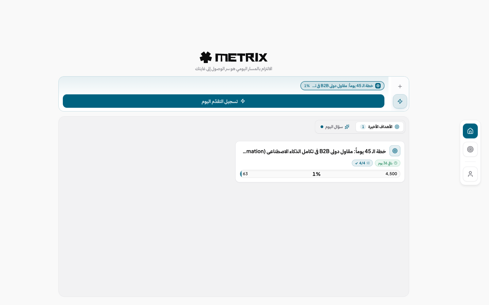
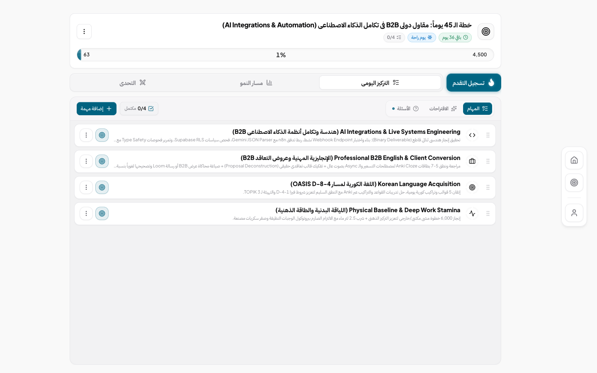
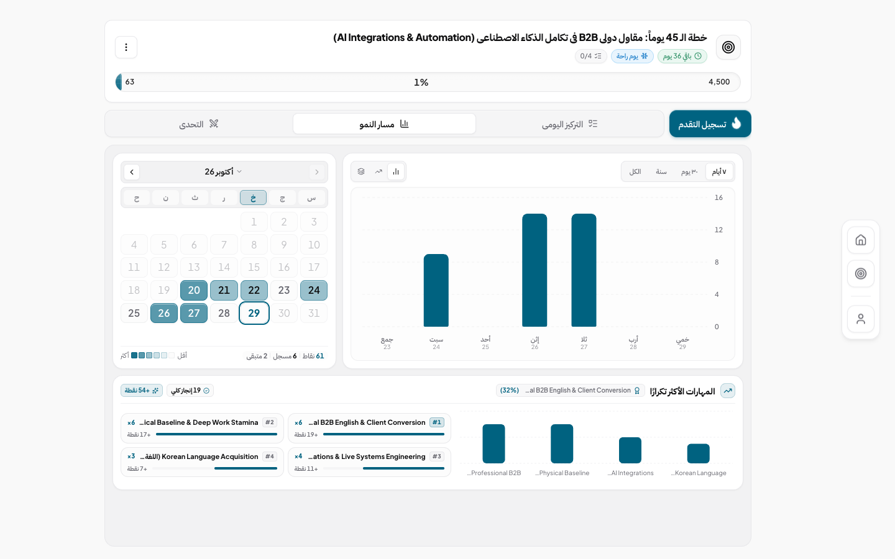
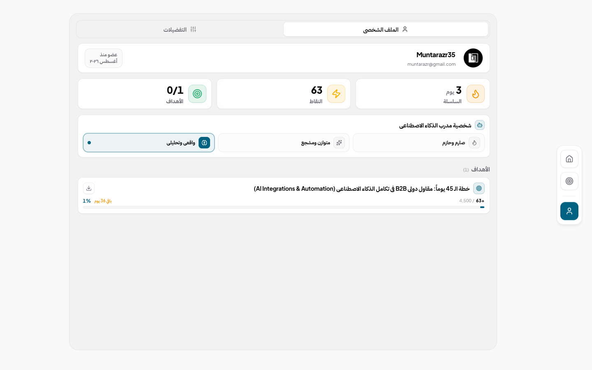
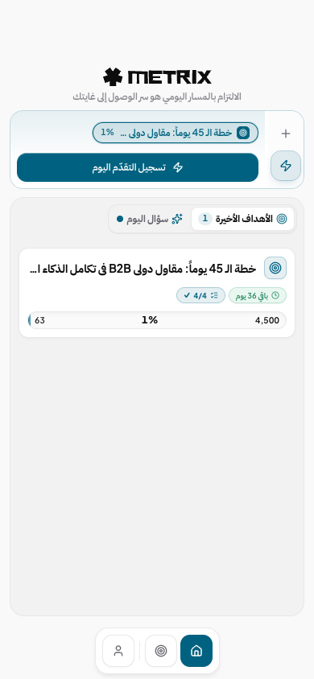

# METRIX

<p align="center">
  
</p>

<p align="center">
  <strong>A strict, quantitative, point-based goal execution and accountability platform evaluated by AI.</strong><br>
  Replace casual to-do lists with rigorous milestone decomposition, daily focus tracking, and unflattering progress audits.
</p>

<p align="center">
  <a href="LICENSE"></a>
  
  
  
  
  
</p>

---

## 📸 Interface Showcase

### 1. Goal Deconstruction & Daily Focus
Break ambitious multi-month goals into strict hierarchical daily milestones with weighted point values and hard daily caps.

<p align="center">
  
</p>

### 2. Trajectory Analytics & 1v1 Duels
Track cumulative productivity over 7, 30, and 90-day intervals, or challenge partners to 1v1 execution duels via invite codes.

<p align="center">
  
  
</p>

### 3. Gamification, Badges & Mobile Experience
Earn system ranks based on verified output, maintain streaks with built-in freeze protections, and access the entire system seamlessly on mobile devices.

<p align="center">
  
  
</p>

---

## ⚡ Core Highlights

- 🎯 **AI & Manual Goal Decomposition:** Convert any ambitious target into actionable subtasks with defined criteria using Google Gemini or manual structured entry.
- ⚖️ **Objective AI Evaluator:** Audio or text check-ins are scored without flattering. Full points require verifiable deliverables; passive effort receives zero.
- 📈 **Quantitative Caps & Streaks:** Enforces mathematical daily caps to prevent fake progress and burnouts, with automatic streak freeze mechanics.
- ⚔️ **Competitive Duels:** Challenge friends or peers to head-to-head accountability competitions with synced goal targets.
- 🌐 **RTL-Native Bilingual Architecture:** Seamless Arabic-first and English bilingual experience built with modern CSS logical properties.
- 📱 **Unified Web & Mobile:** Single codebase powering both the Next.js web application and Android APK export via Capacitor.

---

## 🛠️ Tech Stack

| Layer | Technologies |
|---|---|
| **Frontend** | Next.js 16 (App Router + Turbopack), React 19, Tailwind CSS v4, Lucide Icons |
| **Backend & Database** | Supabase (PostgreSQL with RLS), Google OAuth, Edge Functions |
| **AI Intelligence** | Google Gemini 2.5 (Goal Generation & Evaluation), Mistral (Voice Transcription) |
| **Media & Mobile** | ImageKit (Milestone Media), Capacitor (Android Native Export) |

---

## 🚀 Quickstart

### 1. Clone & Install

```bash
git clone https://github.com/muntarazr/metrix.git
cd metrix
npm install
```

### 2. Configure Environment

Copy `.env.example` to `.env.local` and add your project credentials:

```bash
cp .env.example .env.local
```

Required variables:
- `NEXT_PUBLIC_SUPABASE_URL` & `NEXT_PUBLIC_SUPABASE_ANON_KEY`
- `SUPABASE_SERVICE_ROLE_KEY`
- `GEMINI_API_KEY`
- `MISTRAL_API_KEY`

### 3. Setup Database

Run the consolidated schema in your Supabase SQL Editor:
- [`supabase/setup.sql`](supabase/setup.sql)

### 4. Run Development Server

```bash
npm run dev
```

Open [http://localhost:3000](http://localhost:3000) in your browser.

---

## 🧪 Testing & Verification

```bash
# Run unit & logic test suites (89 passing tests)
npm test

# Type-check TypeScript codebase
npx tsc --noEmit

# Production build test
npm run build
```

---

## 🤖 Agent Skill Integration

METRIX is also packaged as an installable **AI Agent Skill** (`metrix-goal-engine`), allowing agents (Claude Code, Gemini CLI, Antigravity) to decompose goals and evaluate daily check-ins directly in your terminal:

```bash
npx skills add ./skills/metrix-goal-engine
```

Learn more in [skills/metrix-goal-engine/SKILL.md](skills/metrix-goal-engine/SKILL.md).

---

## 🤝 Contributing & Security

- **Contributing:** Please read [CONTRIBUTING.md](CONTRIBUTING.md) for code standards and PR submission guidelines.
- **Security:** To report security concerns responsibly, see [SECURITY.md](SECURITY.md).
- **Roadmap:** Detailed implementation notes are in [docs/OPEN_SOURCE_PLAN.md](docs/OPEN_SOURCE_PLAN.md).

## 📄 License

This project is licensed under the [MIT License](LICENSE).
