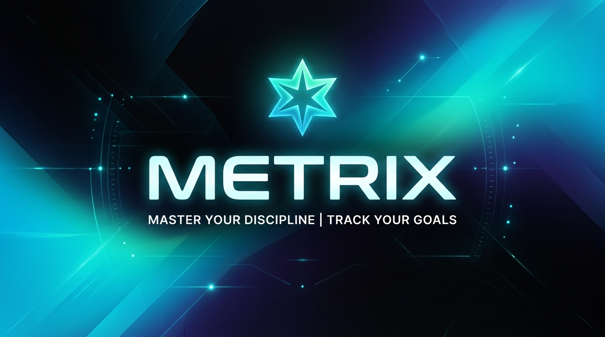

# METRIX

<p align="center">
  
</p>

<p align="center">
  <strong>نظام صارم قائم على النقاط وتقييم الذكاء الاصطناعي لتتبع وتحقيق الأهداف الشخصية</strong><br>
  <em>A strict, point-based personal growth and goal execution platform evaluated by AI.</em>
</p>

<p align="center">
  <a href="LICENSE"></a>
  
  
  
  
</p>

---

## ⚡ الميزات الجوهرية (Key Highlights)

- 🎯 **توليد خطة بالذكاء الاصطناعي (AI Plan Generation):** تحويل وصف أي هدف إلى خطة عمل هرمية متكاملة بضغطة زر عبر Google Gemini، أو بنائها يدوياً.
- ⚡ **التركيز اليومي (Daily Focus):** وضع مهام اليوم الأكثر حساسية في واجهة نقية وموجهة لإنجازها دون تشتيت.
- ⚖️ **تقييم موضوعي ومحاسبة (Strict Evaluator):** تسجيل الإنجاز عبر اليوميات الصوتية أو النصية مع تقييم ذكي يمنح النقاط بناءً على معايير الجودة الصارمة.
- 📈 **مسار النمو والتحليلات (Growth Trajectory):** مخططات بيانية تفاعلية لقياس تراكم النقاط، السلاسل اليومية (Streaks)، وتوثيق المعالم (Milestones).
- ⚔️ **مبارزات التحدي (1v1 Duels):** التنافس المباشر مع صديق على هدف محدد عبر رمز دعوة فوري.
- 📱 **واجهة موحدة للويب والموبايل:** تطبيق متجاوب بالكامل مع دعم تصدير Android عبر Capacitor.

---

## 🛠️ التقنيات المستخدمة (Tech Stack)

| الطبقة | التقنية |
|---|---|
| **Frontend** | Next.js 16 (App Router + Turbopack), Tailwind CSS v4, Lucide Icons |
| **Backend & Auth** | Supabase (PostgreSQL with RLS), Google OAuth, Edge Functions |
| **Intelligence** | Google Gemini (Evaluation & Planning), Mistral (Voice Transcription) |
| **Storage & Mobile** | ImageKit, Capacitor (Android) |

---

## 🚀 التشغيل المحلي السريع (Quickstart)

```bash
# 1. استنساخ المستودع وتثبيت الاعتماديات
git clone https://github.com/muntarazr/metrix.git
cd metrix
npm install

# 2. إعداد متغيرات البيئة
cp .env.example .env.local
# ثم أضف مفاتيح Supabase و Gemini في ملف .env.local

# 3. تشغيل خادم التطوير
npm run dev
```

افتح [http://localhost:3000](http://localhost:3000) في متصفحك.

---

## 🧪 الاختبارات والجودة (Testing & Verification)

```bash
# تشغيل اختبارات المنطق الحساس
npm test

# فحص توافق الأنواع (Type Check)
npx tsc --noEmit

# بناء نسخة الإنتاج
npm run build
```

---

## 🤝 المساهمة والأمان (Contributing & Security)

- للمساهمة في المشروع، يرجى مراجعة [CONTRIBUTING.md](CONTRIBUTING.md).
- للإبلاغ عن أي ثغرة أمنية بمسؤولية، يرجى مراجعة [SECURITY.md](SECURITY.md).
- خطة العمل ومعايير الـ Open Source مفصلة في [docs/OPEN_SOURCE_PLAN.md](docs/OPEN_SOURCE_PLAN.md).

## 📄 الترخيص (License)

هذا المشروع مرخص تحت رخصة [MIT License](LICENSE).
