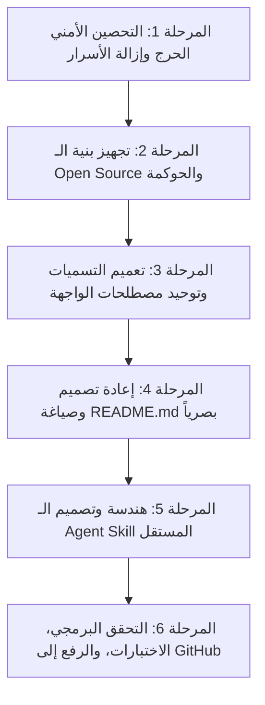

# خطة العمل المتكاملة: تحصين METRIX، جعله مفتوح المصدر (Open Source)، وتطوير Skill مستقل

تحدد هذه الوثيقة خطة العمل التفصيلية لمعالجة الثغرات الأمنية، تجهيز المستودع للنشر كـ **Open Source** بمعايير GitHub العالمية، إعادة صياغة الـ README ليكون بصرياً وموجزاً، وتصميم وبناء مشروع **Agent Skill** مشتق من منهجية METRIX.

---

## 📌 المخطط العام للمراحل (Phased Execution Roadmap)



---

## 🛡️ المرحلة الأولى: التحصين الأمني الحرج وإزالة التسريبات (Critical Security Hardening)

### الأهداف:
إزالة أي بيانات حساسة، مفاتيح API، أو روابط شخصية مضمنة داخل الكود البرمجي (Hardcoded Secrets)، وضمان أمان المستودع 100% قبل النشر العام.

### الخطوات التفصيلية:
1. **تطهير عميل Supabase في الواجهة الأمامية:**
   - الملف: `src/utils/supabase/client.ts`
   - **الإجراء:** إزالة القيم الثابتة `DEFAULT_SUPABASE_URL` و `DEFAULT_SUPABASE_ANON_KEY` التي تشير لمشروع قاعدة البيانات الحي.
   - جعل العميل يعتمد حصراً على `process.env.NEXT_PUBLIC_SUPABASE_URL` و `process.env.NEXT_PUBLIC_SUPABASE_ANON_KEY`.
   - في حال غياب المتغيرات في بيئة التطوير، يتم إرجاع fallback آمن يعرض تنبيهاً واضحاً للمطور بإعداد ملف `.env.local` دون تسريب أي مفتاح.

2. **تأمين ملفات GitHub Actions Workflow:**
   - الملف: `.github/workflows/build-apk.yml`
   - **الإجراء:** استبدال القيم النصية الصريحة للرابط والمفتاح في خطوة بناء الويب بمتغيرات GitHub المحمية:
     ```yaml
     env:
       NEXT_PUBLIC_SUPABASE_URL: ${{ secrets.NEXT_PUBLIC_SUPABASE_URL }}
       NEXT_PUBLIC_SUPABASE_ANON_KEY: ${{ secrets.NEXT_PUBLIC_SUPABASE_ANON_KEY }}
     ```

3. **تنظيف السكربتات المساعدة في `scripts/`:**
   - في `scripts/migrate-to-imagekit.mjs`:
     - استبدال النطاق الشخصي `https://ik.imagekit.io/amalcenter` بمتغير بيئة `process.env.IMAGEKIT_ENDPOINT`.
     - استبدال الرابط الاحتياطي لـ Supabase بالقراءة الإلزامية من `process.env.SUPABASE_URL`.
   - في `scripts/git-push-with-token.sh`:
     - جعل اسم المستودع يُقرأ تلقائياً من إعدادات الـ git remote الحالية بدلاً من كتابة `github.com/muntarazr/metrix.git` بشكل جامد.

4. **فحص الـ `.gitignore` والتأكد من تاريخ Git:**
   - التأكد من حظر:
     - `client_secret*.json`
     - `.env*` (باستثناء `.env.example`)
     - الملفات التراكمية الخاصة بالـ build وأدوات الذكاء الاصطناعي المحلية.

---

## 🌐 المرحلة الثانية: تجهيز بنية الـ Open Source والحوكمة (Repository Governance)

### الأهداف:
تزويد المشروع بالملفات والمعايير التي تجعله مشروعاً مجتمعياً موثوقاً وسهل المساهمة فيه.

### الخطوات التفصيلية:
1. **إضافة ملف الترخيص القياسي (`LICENSE`):**
   - اعتماد ترخيص **MIT License** المفتوح (الأنسب والأكثر انتشاراً للمشاريع الخدمية وواجهات الويب).
2. **إنشاء دليل المساهمة (`CONTRIBUTING.md`):**
   - توضيح هيكل المجلدات (`src/app`, `src/components`, `src/lib`, `supabase`).
   - تعليمات تشغيل بيئة العمل محلياً (`npm install`, إعداد `.env.local`, `npm run dev`).
   - تعليمات تشغيل الفحوصات والاختبارات (`npm test`, `npx tsc --noEmit`, `npm run lint`).
   - معايير إرسال Pull Requests والتسمية الموحدة لـ Commits.
3. **إنشاء سياسة الأمان (`SECURITY.md`):**
   - تحديد آلية الإبلاغ المسؤول عن الثغرات (Responsible Vulnerability Disclosure) مع إرشادات عدم نشر الثغرات في قضايا عامة.
4. **إضافة قوالب GitHub:**
   - قوالب التبليغ عن الأخطاء وطلب الميزات (`.github/ISSUE_TEMPLATE/bug_report.md`, `feature_request.md`).
   - قالب سحب التعديلات (`.github/PULL_REQUEST_TEMPLATE.md`).

---

## 🏷️ المرحلة الثالثة: تعميم التسميات وتوحيد المصطلحات (Generic Naming)

### الأهداف:
إزالة أي بقايا لمسميات خاصة أو تسميات سابقة (مثل `Orbit`) وجعل جميع المصطلحات واضحة، محايدة، ومناسبة لأي مستخدم أو مطور.

### الخطوات التفصيلية:
1. **تحديث ملفات الترجمة (`src/lib/translations/ar.ts` و `en.ts`):**
   - استبدال مسميات `Orbit` مثل:
     - `settingsSubtitle`: تحويلها من "خصص تجربتك في Orbit" إلى "تخصيص تجربة الاستخدام والإشعارات".
     - `tierNovice`: تحويلها من "مستكشف Orbit" إلى "مستكشف مبتدئ" / "Explorer".
     - `loadingOrbit`: تحويلها إلى "جاري التحميل" / "Loading System".
     - `orbitCompletion`: تحويلها إلى "نسبة إنجاز الهدف" / "Goal Completion".
     - `orbitProfile` و `orbitSettings`: توحيدها إلى "الملف الشخصي" و "الإعدادات".
2. **مراجعة أقسام لوحة التحكم الرئيسية:**
   - **نظرة عامة / الرئيسية (Overview & Home):** لمتابعة مجمل الأهداف والتركيز الحالي.
   - **الأهداف التفصيلية (Goals & Roadmaps):** بناء الخطط وتقسيم المهام.
   - **التركيز اليومي (Daily Focus):** إنجاز الأولويات وتسجيل التقدم.
   - **التحليلات والمؤشرات (Analytics & Trajectory):** مراقبة النقاط والـ Streaks ومعدلات الاستمرارية.
   - **التحديات (Challenges / 1v1 Duels):** التنافس على الالتزام.
   - **الإنجازات والرتب (Achievements & System Tiers):** سجل الأوسمة والمستويات.

---

## 📖 المرحلة الرابعة: صياغة الـ README.md بتصميم عصري وبصري

### الأهداف:
كتابة ملف `README.md` احترافي ومختصر، غني بالشارات (Badges) والمعاينات البصرية، يسهل قراءته في 90 ثانية.

### مكونات الـ README الجديد:
1. **الترويسة والشارات (Badges):**
   - ترخيص MIT، Next.js 16، TypeScript، Tailwind CSS، Supabase، و RTL-Ready.
2. **نبذة مركزة (Elevator Pitch):**
   - سطران يوضحان ماهية النظام: "نظام صارم قائم على النقاط وتقييم الذكاء الاصطناعي لتحويل الأهداف إلى مهام يومية قابلة للقياس".
3. **الميزات الجوهرية (Core Highlights):**
   - جدول موجز أو بطاقات نقطية توضح: الخطة الذكية، التركيز اليومي، التحليلات، والتحديات.
4. **معاينات بصرية وتصاميم (Interface Showcase):**
   - شاشات وتصاميم توضح واجهة الدارك مود الكونية، الدوك العائم (Gooey Dock)، وتقسيم المهام.
5. **التشغيل السريع في 4 خطوات (Quick Start):**
   ```bash
   git clone https://github.com/muntarazr/metrix.git
   cd metrix && npm install
   cp .env.example .env.local
   npm run dev
   ```
6. **مصفوفة التقنيات (Tech Stack):** جدول من 4 صفوف يلخص معمارية التطبيق.

---

## 🤖 المرحلة الخامسة: بناء مشروع الـ Agent Skill المستقل

### الإجابة: هل يمكن تحويل منهجية METRIX إلى Skill كامل؟
**نعم، بكل تأكيد!**
يمكن استخلاص المنطق الصارم الذي بنيت عليه منصة METRIX (التقسيم الهرمي للمهام، حساب النقاط، قواعد الـ Streaks، التقييم الموضوعي للإنجاز اليومي عبر LLM Evaluator) وتحويله إلى **Agent Skill** قياسي يركب على وكلاء الذكاء الاصطناعي (Claude Code, Gemini CLI, Antigravity, OpenCode).

### هيكل مشروع الـ Skill المقترح:
```text
metrix-goal-skill/
├── SKILL.md                  # الدليل الإرشادي الكامل للوكيل (System Prompt & Rules)
├── package.json              # حزمة الـ Skill
├── README.md                 # دليل التثبيت عبر npx skills add
├── references/
│   ├── scoring-system.md     # لوائح احتساب النقاط الصارمة (Cap, Streaks, Penalties)
│   ├── prompt-templates.md   # قوالب التقييم للذكاء الاصطناعي (Evaluation Schemas)
│   └── hierarchy-rules.md    # قواعد تقسيم الهدف إلى مهام فرعية وأوقات إنجاز
└── scripts/
    ├── log-progress.mjs      # أداة CLI سريعة لتسجيل الإنجاز
    └── evaluate-goal.mjs     # أداة فحص موضوعية لمعايير الإنجاز
```

### وظائف الـ Skill عند تفعيله:
1. **تفكيك أي هدف يطرحه المستخدم** إلى مهام رئيسية وفرعية موزونة بالنقاط تلقائياً وفق معادلات METRIX.
2. **تقييم إنجاز المستخدم اليومي بصرامة** دون مجاملة، وتحديد ما إذا كان مستحقاً للنقاط الكاملة أو الجزئية.
3. **تقديم مراجعة أسبوعية (Weekly Review)** تكشف نقاط القصور وتوصي بإجراءات تصحيحية.

---

## 🚀 المرحلة السادسة: التحقق، الاختبار، والرفع على GitHub

### خطوات الإنجاز:
1. **الفحص البرمجي الكامل:**
   - تشغيل اختبارات المنطق الحساس: `npm test`.
   - التأكد من خلو المشروع من أخطاء الـ Types: `npx tsc --noEmit`.
   - التأكد من بناء المشروع بنجاح: `npm run build`.
2. **تجهيز وإرسال الـ Commits:**
   - Commit 1: `fix(security): sanitize hardcoded credentials and secure action workflows`
   - Commit 2: `feat(oss): add license, contributing guide, and security policy`
   - Commit 3: `refactor(naming): generalize system terms and clean legacy orbit copy`
   - Commit 4: `docs: redesign visual and concise README.md`
3. **الدفع إلى المستودع (Push to GitHub):**
   - مزامنة التغييرات ودفع الفروع لـ `origin main`.
