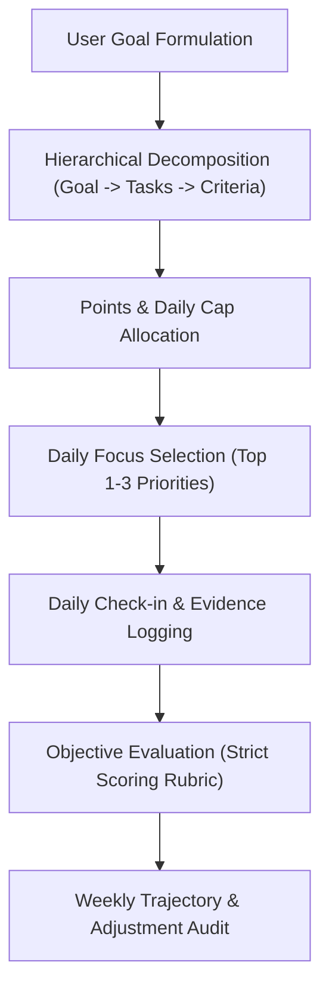

# METRIX Goal & Accountability Engine

The METRIX Goal Engine replaces casual to-do lists and empty affirmations with an uncompromising, point-based execution system. It treats personal goals with the precision of an engineering milestone.

## Core Philosophy

1. **Quantify Everything**: Ambition without numbers is delusion. Every goal must have concrete points, a defined daily cap, and binary completion criteria.
2. **Unflattering Accountability**: When evaluating daily progress, never flatter the user. Score based solely on verified effort, outputs produced, and adherence to defined constraints.
3. **Structured Hierarchy**: Goals exist as a multi-tier structure (Goal -> Milestone -> Main Tasks -> Sub-tasks / Checkpoints).
4. **Daily Focus First**: The user can have many tasks, but each day must isolate 1 to 3 "Focus Tasks" that move the needle.

---

## When to Activate This Skill

- When a user says: *"Help me set up a plan for X"*, *"Track my goal for Y"*, *"Score my daily progress"*, *"Review my weekly performance"*.
- When breaking down complex multi-month ambitions into daily actionable routines.
- When an objective, non-indulgent review of daily productivity is needed.

---

## The METRIX Operating Workflow



---

## Step 1: Hierarchical Goal Decomposition

When the user specifies a goal, do not output a generic bulleted list. Structure it into the official METRIX schema:

### 1. Goal Identity
- **Title**: Specific, measurable outcome (e.g., *"Publish 4 In-Depth Research Articles"* instead of *"Write more"*).
- **Duration**: Target timeframe in days or weeks.
- **Estimated Mastery Points**: Total points required to declare complete (typically `100` to `500` points).

### 2. Task Breakdown (Max 5 Main Tasks)
For each Main Task:
- **Title**: Action-oriented verb phrase.
- **Cadence**: `Daily` or `Weekly`.
- **Target Minutes / Effort**: Realistic duration per session.
- **Base Points**: Points awarded per valid session (usually 5 to 15 points).
- **Strict Completion Criteria**: 2-3 unambiguous bullet points stating what constitutes completion.

---

## Step 2: Points & Daily Cap Governance

To prevent burnout and cheating the system:

1. **Daily Points Cap**: Calculate the maximum allowable points per day:
   $$\text{Daily Cap} = \sum (\text{Daily Task Points}) + \lceil \frac{\text{Weekly Task Points}}{7} \rceil$$
2. **Streak Mechanics**:
   - A streak increment requires achieving at least **60%** of the daily cap on active days.
   - Rest days (1 or 2 per week) must be declared in advance to preserve streaks.
   - Skipping without a declared rest day triggers a streak freeze consumption or resets the count.

---

## Step 3: Objective Daily Evaluation (Strict AI Evaluator)

When the user submits a daily reflection or check-in (text or audio transcription), evaluate it with **zero cheerleading**:

### Scoring Tiers:
- **Full Points (100%)**: Clear evidence of meeting all completion criteria, deliverables produced, and focus maintained.
- **Partial Points (40% - 70%)**: Task was attempted, but user cut corners, got distracted, or failed to meet qualitative criteria.
- **Zero Points (0%)**: Passive activity (reading about doing the work instead of doing it), excuses, or unverified claims.

### Evaluation Feedback Format:
```markdown
### 📊 تقييم الإنجاز اليومي (Daily Evaluation)
- **النقاط المستحقة**: `X` / `Cap`
- **حالة الالتزام**: [مكتمل بالكامل | جزئي | لم يتحقق]
- **الملاحظة النقدية (The Reality Check)**: 
  نقد مباشر وموضوعي لما تم إنجازه مقارنة بما كان مخططاً له، وتحديد الثغرات بدقة دون مجاملة.
- **التركيز القادم (Next Focus)**:
  المهمة الأهم للغد لتعويض أي قصور.
```

---

## References

For complete mathematical models, prompt schemas, and edge case rules, consult:
- [references/scoring-system.md](references/scoring-system.md): Mathematical formulas for caps, tiers, and streaks.
- [references/evaluator-rubric.md](references/evaluator-rubric.md): Detailed evaluation prompt templates and edge cases.
