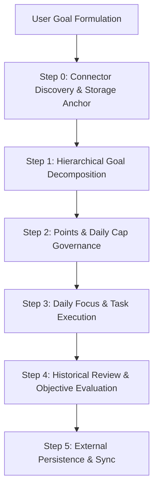

# METRIX Goal & Accountability Engine

The METRIX Goal Engine replaces casual to-do lists and conversational drift with an uncompromising, point-based execution system anchored in **persistent external storage**.

## Core Philosophy

1. **Persist Beyond Chat Memory**: Chat context is volatile, subject to summarization loss and hallucination. Every goal, task definition, and evaluation log **must be anchored to external storage** (Database, Docs, or Local Vault).
2. **Quantify Everything**: Ambition without numbers is delusion. Every goal must have concrete points, a defined daily cap, and binary completion criteria.
3. **Unflattering Accountability**: When evaluating daily progress, never flatter the user. Score based solely on verified effort, outputs produced, and adherence to defined constraints.
4. **Historical Continuity**: Always review previous tasks and check-ins before evaluating new submissions. Never evaluate in isolation.

---

## When to Activate This Skill

- When a user says: *"Help me set up a plan for X"*, *"Track my goal for Y"*, *"Score my daily progress"*, *"Review my tasks / past progress"*, *"Where are my goals saved?"*.
- When breaking down complex multi-month ambitions into daily actionable routines.
- When an objective, non-indulgent review of daily productivity is needed with permanent history tracking.

---

## The METRIX Operating Workflow



---

## Step 0: Connector Discovery & Storage Anchor (Mandatory First Step)

**Never keep goals or progress exclusively inside conversational memory.**

Before creating or evaluating goals, identify available connectors and ask the user where their data should be stored:

### 1. Check Available Adapters:
- **🗄️ Database Connector**: Check for `NEXT_PUBLIC_SUPABASE_URL` / `DATABASE_URL` in `.env.local` or active Supabase/PostgreSQL connections.
- **📄 Cloud Docs / Notes Connector**: Check for active Google Drive/Docs MCP, Notion MCP, or Obsidian paths.
- **📁 Local Project Vault (Default)**: `.metrix/goals.json` and `.metrix/logs/` in the workspace root.

### 2. Confirm with User:
> *"To ensure your goals and progress are permanently tracked and never lost between conversations, where would you like to store your data?*
> 1. **📁 Local Workspace Vault** (`.metrix/` folder in this repo — zero-config & offline)
> 2. **🗄️ Database Connector** (Supabase / Postgres sync with live app)
> 3. **📄 Cloud Document / Notion** (Google Docs, Sheets, or Notion page)*"

---

## Step 1: Hierarchical Goal Decomposition

When the user specifies a goal, do not output a generic bulleted list. Structure it into the official METRIX schema:

### 1. Goal Identity
- **Title**: Specific, measurable outcome (e.g., *"Publish 4 In-Depth Research Articles"* instead of *"Write more"*).
- **Duration**: Target timeframe in days or weeks.
- **Mastery Target Points**: Total points required to declare complete (typically `500` to `5000` points).
- **Daily Points Cap**: Strict ceiling preventing cramming or inflated fake progress.

### 2. Task Breakdown (3 to 5 Main Tasks)
For each Main Task:
- **ID**: kebab-case identifier (e.g. `task-core-eng`).
- **Title**: Action-oriented verb phrase.
- **Cadence**: `Daily` or `Weekly`.
- **Target Minutes / Effort**: Realistic duration per session.
- **Base Points**: Points awarded per valid session (usually 5 to 15 points).
- **Strict Completion Criteria**: 2-3 unambiguous bullet points stating what constitutes completion.

Write the structure immediately to the selected storage adapter (e.g. `.metrix/goals.json` or Database table).

---

## Step 2: Points & Daily Cap Governance

To prevent burnout and cheating the system:

1. **Daily Points Cap**: Calculate the maximum allowable points per day:
   $$\text{Daily Cap} = \sum (\text{Daily Task Points}) + \lceil \frac{\text{Weekly Task Points}}{7} \rceil$$
2. **Streak Mechanics**:
   - A streak increment requires achieving at least **60%** of the daily cap on active days.
   - Rest days (1 or 2 per week) must be declared in advance to preserve streaks.
   - Skipping without a declared rest day triggers a streak freeze consumption or resets the count.

---

## Step 3: Historical Review & Audit (Before Every Evaluation)

Before scoring any new check-in:
1. **Retrieve Past Tasks**: Read the latest log from storage (e.g., `.metrix/logs/` or `daily_logs` table).
2. **Check Unfinished Work**: Compare current claims against previous bottlenecks and commitments.
3. **Audit Continuity**: Ensure user isn't claiming progress on tasks that depend on uncompleted prerequisites.

---

## Step 4: Objective Daily Evaluation (Strict AI Evaluator)

When the user submits a daily reflection or check-in (text, audio, or command proof), evaluate it with **zero cheerleading**:

### Scoring Tiers:
- **Full Points (100%)**: Clear evidence of meeting all completion criteria, deliverables produced, and focus maintained.
- **Partial Points (40% - 70%)**: Task was attempted, but user cut corners, got distracted, or failed to meet qualitative criteria.
- **Zero Points (0%)**: Passive activity (reading about doing the work instead of doing it), excuses, or unverified claims.

### Evaluation Feedback Format:
```markdown
### 📊 تقييم الإنجاز اليومي (Daily Evaluation)
- **الهدف المستهدف**: [Goal Title]
- **النقاط المستحقة**: `X` / `Cap`
- **حالة الالتزام**: [مكتمل بالكامل | جزئي | لم يتحقق]
- **الملاحظة النقدية (The Reality Check)**: 
  نقد مباشر وموضوعي لما تم إنجازه مقارنة بما كان مخططاً له، وتحديد الثغرات بدقة دون مجاملة.
- **التركيز القادم (Next Focus)**:
  المهمة الأهم للغد لتعويض أي قصور بناءً على سجل الأداء التاريخي.
```

---

## Step 5: External Persistence & Sync

Immediately write the evaluation results to the external storage destination:
- For **Local Vault**: Append/write `.metrix/logs/YYYY-MM-DD.md` and update `.metrix/goals.json`.
- For **Database**: Insert row into `daily_logs` and `task_checkins`.
- For **Cloud Docs / Notion**: Append date section with awarded score and reality check summary.

Confirm persistence with the user:
> *"✅ Log saved permanently to [Storage Path/Destination]. Current Streak: X days | Total XP: Y."*

---

## References

For complete mathematical models, prompt schemas, and storage structures, consult:
- [references/connectors-and-storage.md](references/connectors-and-storage.md): Supported storage adapters and connection guidelines.
- [references/state-schema.md](references/state-schema.md): Complete JSON & Markdown schemas for external dossiers.
- [references/scoring-system.md](references/scoring-system.md): Mathematical formulas for caps, tiers, and streaks.
- [references/evaluator-rubric.md](references/evaluator-rubric.md): Detailed evaluation prompt templates and edge cases.
