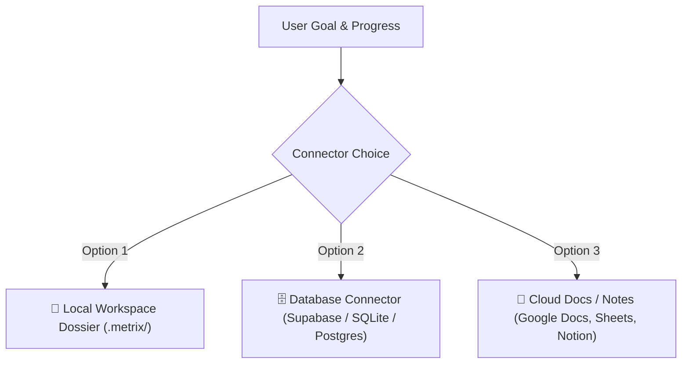

# METRIX Connectors & Persistent Storage Engine

To prevent context drift, hallucinations, and loss of progress across chat sessions, **never rely on chat memory alone**. METRIX requires external, persistent storage for goals, tasks, check-ins, and performance logs.

---

## 🔌 Supported Storage Adapters (Connectors)

When initializing or executing goals, identify which connector is active or ask the user to select their preferred adapter:

### 1. 📁 Local Workspace Vault (Default & Zero-Config)
- **Path**: `.metrix/` in the user's workspace root.
- **Files**:
  - `.metrix/goals.json` — Master index of all active and completed goals, milestones, tasks, and point values.
  - `.metrix/logs/YYYY-MM-DD.md` — Daily evaluation dossier with verbatim evidence, score breakdown, and next focus.
  - `.metrix/state.json` — Real-time streak count, total XP, tier rank, and freeze inventory.
- **Pros**: Zero external dependencies, persists in Git repository, works fully offline.

### 2. 🗄️ Database Connector (Supabase / Postgres / SQLite)
- **Detection**: Checks if `NEXT_PUBLIC_SUPABASE_URL` or `DATABASE_URL` exists in `.env.local` or environment.
- **Tables**:
  - `goals` — id, title, target_points, current_points, cadence.
  - `sub_layers` / `tasks` — id, goal_id, title, criteria, base_points.
  - `task_checkins` — task_id, completed, points_awarded, period_start.
  - `daily_logs` — goal_id, user_input, ai_score, ai_feedback, breakdown (JSON).
- **Pros**: Real-time sync with mobile/web dashboards, multi-device access.

### 3. 📄 Cloud Docs & Note Connectors (Google Docs, Sheets, Notion, Obsidian)
- **Detection**: Inspects connected MCP servers (e.g., Google Drive MCP, Notion MCP, File System MCP).
- **Format**:
  - **Google Docs / Notion**: Dedicated page titled `[METRIX] Goal: <Title>`, appending daily check-in blocks with date headers and score badges.
  - **Google Sheets**: Tabular log tracking `Date | Task | Completion Criteria | Score | Evaluator Feedback`.

---

## 🔍 Connector Discovery Protocol

Before saving any goal or evaluating progress:
1. **Inspect Environment**: Check for `.env.local`, `.metrix/` folder, or connected database/docs MCP tools.
2. **Confirm with User**:
   > *"Where would you like to anchor and track your goals and progress?*
   > *1. 📁 Local Project Vault (`.metrix/` files in this repository)*
   > *2. 🗄️ Supabase / Postgres Database (Sync with live dashboard)*
   > *3. 📄 Cloud Docs / Notion (Document tracking)*"
3. **Persist Immediately**: Write the goal schema to the chosen destination before proceeding.
